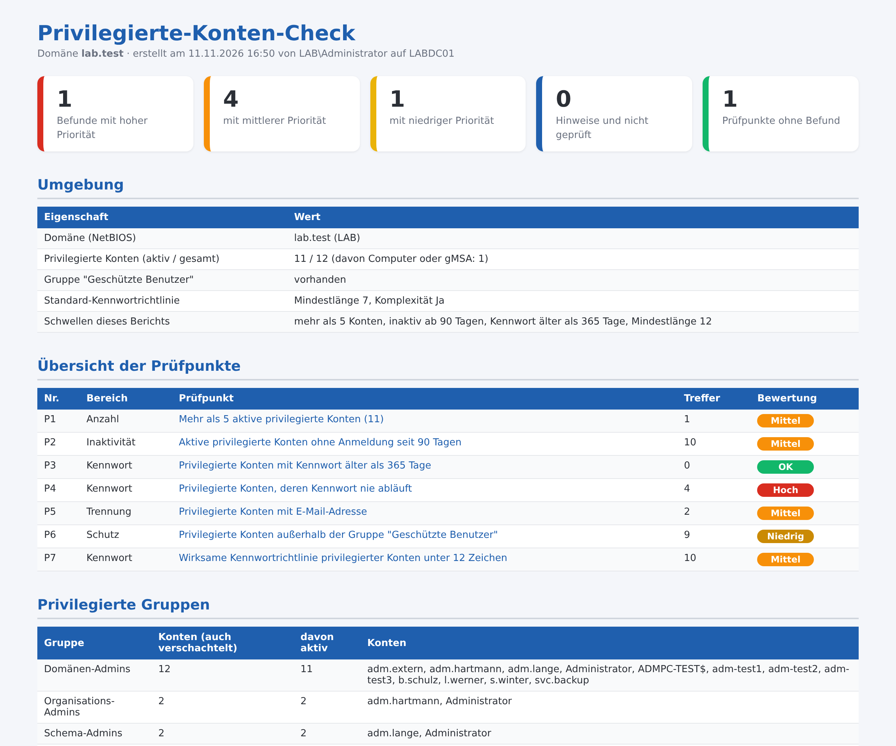

# Privilegierte-Konten-Check – wer hat Administratorrechte im Active Directory?

Kostenloses PowerShell-Skript: zeigt, **wer in Ihrem Active Directory Administratorrechte hat**, auch über verschachtelte Gruppen, und prüft diese Konten in **7 Punkten**. Ergebnis ist ein übersichtlicher **HTML-Bericht auf Deutsch**. Es arbeitet **ausschließlich lesend**: Es ändert nichts, legt nichts an und überträgt keine Daten.



Der gezeigte Bericht stammt aus einer Testdomäne. Das vollständige Beispiel liegt als [Beispielbericht.html](Beispielbericht.html) bei.

## Was geprüft wird

| Nr. | Bereich | Prüfpunkt |
|---|---|---|
| P1 | Anzahl | Mehr als 5 aktive privilegierte Konten (einstellbar) |
| P2 | Inaktivität | Aktive privilegierte Konten ohne Anmeldung seit 90 Tagen (einstellbar); nie angemeldete Konten erst, wenn sie älter als die Frist sind |
| P3 | Kennwort | Privilegierte Konten mit Kennwort älter als 365 Tage (einstellbar) |
| P4 | Kennwort | Privilegierte Konten, deren Kennwort nie abläuft |
| P5 | Trennung | Privilegierte Konten mit E-Mail-Adresse (Adminkonto zugleich Alltagskonto) |
| P6 | Schutz | Privilegierte Benutzerkonten außerhalb der Gruppe „Geschützte Benutzer“ (Computer und gMSA sind ausgenommen) |
| P7 | Kennwort | Wirksame Kennwortrichtlinie unter 12 Zeichen (auch abweichende Richtlinien je Konto, Password Settings Objects) |

Als privilegiert gelten Mitglieder von Domänen-Admins, Organisations-Admins, Schema-Admins, Administratoren, Konten-Operatoren, Server-Operatoren und Sicherungs-Operatoren. Die Gruppen werden über ihre festen Kennungen (SID) gefunden, das Skript funktioniert deshalb in jeder Windows-Sprache. Jeder Befund kommt mit Erklärung und Empfehlung; dazu gibt es die Liste aller privilegierten Konten je Gruppe.

## Start

```powershell
powershell -ExecutionPolicy Bypass -File .\Privilegierte-Konten-Check.ps1
```

Optionen: `-MaxAdmins <Zahl>`, `-InaktivTage <Zahl>`, `-KennwortAlterTage <Zahl>`, `-MindestLaenge <Zahl>`, `-Csv`, `-Ausgabe <Pfad>`, `-Server <DC>`, `-Anmeldung (Get-Credential)`, `-NichtOeffnen`, `-PassThru`. Alle Optionen zeigt `Get-Help .\Privilegierte-Konten-Check.ps1 -Detailed`.

**Voraussetzungen:** Windows PowerShell 5.1, das Modul `ActiveDirectory` (auf Domänencontrollern vorhanden, sonst RSAT) und ein normales Domänenkonto mit Leserechten. Administratorrechte sind nicht erforderlich. Ohne Leserecht auf die Kennwortrichtlinien (Password Settings Container) zeigt P7 für Konten mit eigener Richtlinie „nicht geprüft“. Getestet mit Windows Server 2025 (deutsch) in einer Testdomäne mit zwei Domänencontrollern; jeder Prüfpunkt wurde mit nachgestellten Konten ausgelöst. Mitglieder werden auch über verschachtelte Gruppen und über die primäre Gruppe gefunden, ebenso Computerkonten und verwaltete Dienstkonten (Computerkonto, gMSA und ein Konto, das nur über die primäre Gruppe privilegiert ist, wurden im Test gefunden; in einer zweiten, unabhängigen Testumgebung bestätigt). Nicht getestet: Umgebungen mit mehreren Domänen oder Gesamtstrukturen; dort werden Mitglieder aus anderen Domänen nicht erfasst.

## Vollversion

Dieses Skript ist ein eigenständiger, kostenloser Ausschnitt. Der **AD-Prüfbericht** im Shop prüft Active Directory umfassender (21 Prüfpunkte, Anleitung als PDF), unter anderem:

- Deaktivierte Konten und verschachtelte Gruppen in privilegierten Gruppen
- Dienstkonten mit Administratorrechten und Konten mit Dienstprinzipalnamen (Kerberoasting)
- Mögliches Kennwort im Beschreibungsfeld, Alter des krbtgt-Kontos
- Domänen-Kennwortrichtlinie, inaktive Konten, leere Gruppen, AD-Papierkorb

Dazu kommen der **Kerberos-Altlasten-Check** (Delegierung, schwache Verschlüsselung, alte Protokolle) und der **Berechtigungsbericht** (DCSync-Rechte, Delegierung auf Organisationseinheiten).

➜ **[AD-Prüfbericht auf Gumroad](https://mueller86.gumroad.com/l/fcneoc)** · **[alle Skripte auf Gumroad](https://mueller86.gumroad.com)** · **[IT Admin Tools by MM auf Etsy](https://www.etsy.com/shop/ITAdminToolsbyMM)**

## Weitere kostenlose Skripte

- [AD-Schnellcheck](https://github.com/jackyno7/ad-schnellcheck) (8 Prüfpunkte zur Domäne)
- [Zertifikate-Bericht](https://github.com/jackyno7/zertifikate-bericht) (abgelaufene und bald ablaufende Zertifikate auf Windows-Servern)

## Hinweise

- Der Bericht enthält Konto- und Gruppennamen – bitte vertraulich behandeln.
- Die Konten Gast, krbtgt und DefaultAccount werden nie aufgeführt, auch wenn sie in einer privilegierten Gruppe stehen. Konten mit „Kennwort bei nächster Anmeldung ändern“ erscheinen nicht unter P3. Der Bericht nennt die oberste privilegierte Gruppe, nicht den Verschachtelungspfad.
- Der Zeitpunkt der letzten Anmeldung wird zwischen Domänencontrollern nur alle 14 Tage abgeglichen und ist nur ein Anhaltspunkt.
- Der Bericht zeigt Auffälligkeiten anhand fester Regeln. Er ersetzt keine Sicherheitsprüfung und erhebt keinen Anspruch auf Vollständigkeit.
- Nutzung auf eigene Verantwortung, siehe [LICENSE](LICENSE).
- Bei der Ausarbeitung wurden KI-Werkzeuge unterstützend eingesetzt; Inhalte und Skript wurden fachlich geprüft und im Testlab getestet.

---

### English

Free, read-only PowerShell script that lists who has administrator rights in an Active Directory (including nested groups) and checks those accounts in 7 points: count, inactivity, password age, password never expires, mailbox on admin account, Protected Users membership and effective password policy. German HTML report with findings and recommendations. Nothing is changed and no data leaves the machine. Run: `powershell -ExecutionPolicy Bypass -File .\Privilegierte-Konten-Check.ps1`.
